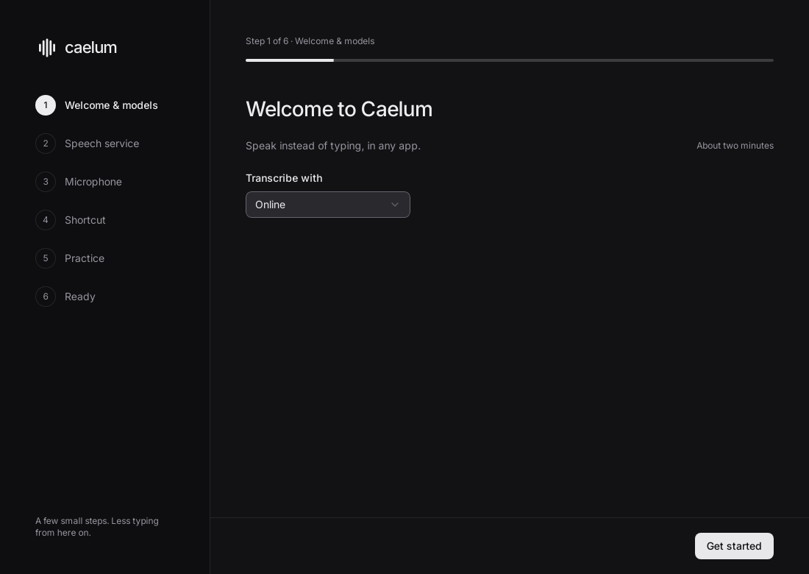

# Caelum

Record your voice, finish, then copy the transcript into the app you’re using.

**[Download stable](https://github.com/Parth-Jadhav-2004/caelum/releases/latest)** · **[Testing and development releases](https://github.com/Parth-Jadhav-2004/caelum/releases)** · [Linux troubleshooting](docs/linux.md)

**[Invite-only beta installation and first paste](https://github.com/Parth-Jadhav-2004/caelum/blob/beta-guide/README.md)** · [Desktop test checklist](https://github.com/Parth-Jadhav-2004/caelum/issues/26)

Stable **0.4.2** uses your API provider. The **0.5.0 candidate** adds an equally supported **On this computer** setup path; it is not a stable download. Models download separately; select one matching your memory, language and license in setup. Local speech needs no cloud key, upload consent or network after provisioning. Online uses your own provider key and may incur charges. Optional cleanup sends text to the configured cleanup provider. [Privacy and storage](docs/privacy.md).

Packages target **x86-64 Ubuntu 24.04/26.04, Debian 12, Fedora 43 and Arch**. Download only the matching package and its `SHA256SUMS`. Architecture and distribution support do not certify a desktop session.

Open Caelum, choose your speech mode, test the microphone, and complete practice. On portable desktops use **Record → Finish recording**. With history on, copy the result from History; with history off, paste directly from the clipboard. Paste into an editor to confirm delivery. A denied or unavailable global shortcut does not prevent the on-screen workflow. Hyprland adds native shortcuts, overlay and insertion. [Desktop qualification](docs/acceptance.md) is separate from package smoke tests.



*Actual Ubuntu 24.04 candidate package in [automated X11 smoke](https://github.com/Parth-Jadhav-2004/caelum/actions/runs/44309773651), not a GNOME/KDE qualification.*

**Stable 0.4.2 installation** — run just the command for your downloaded package:

```sh
sudo apt install ./caelum_0.4.2-1_ubuntu-24.04_amd64.deb
sudo apt install ./caelum_0.4.2-1_ubuntu-26.04_amd64.deb
sudo apt install ./caelum_0.4.2-1_debian-12_amd64.deb
sudo dnf install ./caelum-0.4.2-1.fedora43.x86_64.rpm
sudo pacman -U ./caelum-0.4.2-1-x86_64.pkg.tar.zst
```

For an RC, use the package filename on its own release page. [Microphone, shortcut, tray, blank window and uninstall help](docs/linux.md#first-run-help).

## Development

To try the native app on a clean checkout with a fresh profile, follow [Try dev on Linux](docs/try-dev.md).

Requires Node 24+, Rust stable, uv, Python 3.11+, PortAudio, WebKitGTK 4.1,
a C/C++ toolchain, pkg-config, and libayatana-appindicator/libappindicator.

```sh
uv sync --locked --extra dev --extra local --python /usr/bin/python3
npm ci
npm run tauri dev
```

For the optional native Hyprland overlay, use the distro Python with its GI/Cairo
modules available (`uv venv --system-site-packages --python /usr/bin/python3
--allow-existing`) and install GTK4 and gtk4-layer-shell. The main window does
not import PyGObject. Tauri's Linux WebView uses GTK3/WebKitGTK internally.

The first run opens Speech → Microphone → Shortcut → Practice. Choose **On this
computer** for downloaded models or **Online** for an API provider. Downloads
continue during setup and while the window is hidden to the tray. The mic test
is local. Only Online practice requires upload consent; local practice never
falls back to an upload. Keys use Secret Service when available, otherwise
an owner-only file with an explicit unencrypted-storage disclosure.

```sh
npm run check                       # ESLint, React tests, strict TS, Vite build
uv run ruff check python tests scripts
uv run pytest -q
uv run python scripts/generate-contracts.py
cargo check --manifest-path src-tauri/Cargo.toml
npm run tauri build -- --no-bundle   # native executable, packaging step below
```

`npm run dev` serves only the frontend; IPC requires `tauri dev`. The standalone
web page is not a simulated transcription service.

## Architecture

- `src/features`: dashboard, retained-history statistics/calendar, searchable
  transcripts, settings/advanced providers, and consented onboarding.
- `src/components/ui`: shadcn components retrieved using the shadcn CLI.
- `src/lib`: typed IPC and generated Python configuration types.
- `src/hooks`, `src/stores`: native event subscription and Zustand navigation/status.
- `src-tauri`: single-instance window, tray, capability policy, command transport,
  bounded request timeouts, process supervision, and orderly shutdown.
- `python/caelum`: existing PortAudio/NumPy audio, HTTPX/asyncio providers,
  conservative cleanup/chunking, SQLite, TOML, key storage, MPRIS, D-Bus,
  Hyprland and portal shortcuts. `sidecar.py` adapts these services over JSON lines.

The existing UID-checked daemon socket remains compatible with `caelum control`.
Native shortcuts retain target-addressed paste, Escape cancellation, lock/suspend
safety, MPRIS pause/resume, and retryable audio held only in bounded memory.
Portable desktops retain portal shortcuts where available, Record/Finish, explicit
copy, and desktop notifications. Closing the main window keeps it alive only when
a tray watcher is available; quitting stops the service after confirmation.

Data paths and formats are preserved: `$XDG_CONFIG_HOME/caelum/config.toml`,
credentials/setup metadata alongside it, and
`$XDG_DATA_HOME/caelum/history.sqlite3`. Defaults fall back to standard XDG paths.
No SQL schema migration or credential copying is performed.

## Distribution packages

Build **inside the target distribution**, with its system Python and native build
libraries. The native package builder vendors the hashed `uv.lock` Python wheels
under `/opt/caelum/lib`; end users do not run pip or create a virtual environment.
System Python, audio libraries, WebKitGTK, and native helpers are declared package
dependencies. GTK4/GI/Cairo are needed only for the isolated native overlay.

```sh
python3 scripts/build_package.py ubuntu-24.04
python3 scripts/build_package.py ubuntu-26.04
python3 scripts/build_package.py debian-12
python3 scripts/build_package.py fedora-43
python3 scripts/build_package.py arch
```

Outputs go to `dist/`: `.deb`, `.rpm`, or `.pkg.tar.zst`. Install using `apt install
./…deb`, `dnf install ./…rpm`, or `pacman -U …pkg.tar.zst`. The Arch PKGBUILD
in `packaging/arch` invokes the same builder; it checks out the matching release Git tag. GitHub Actions builds, installs, and smoke-tests each target
package before publishing signed update metadata. Release signing still requires
the existing Ed25519 signing secret; no signing key is included in this repository.

Direct `tauri build` bundles are development artifacts: use the native package
builder for the complete vendored Python payload and distro dependency metadata.

## Platform limits and acceptance

Tauri cannot place ordinary windows reliably on Wayland or provide the original
click-through layer-shell contract. `python/caelum/hud.py` is intentionally retained
as a separate GTK4 layer-shell helper; it is the only GTK4 UI. It never becomes a
competing main window. GNOME and other compositors without layer-shell use portable
notifications rather than a falsely equivalent overlay. Native Hyprland integration
requires the existing Lua-capable compositor API. Other desktops use manual paste.

Read [migration mapping](docs/migration.md), [architecture](docs/architecture.md),
[Linux prerequisites](docs/linux.md), and [acceptance checks](docs/acceptance.md).
Hardware recording, real provider uploads, desktop permissions, tray behavior,
suspend/lock, and installation on each distribution require host acceptance testing.
Do not interpret passing mocked tests as production certification.

## Appearance

Settings → General → Theme → **Color theme** selects T3 Code (the default), T3 Chat,
Grove, Ocean, Ember, Iris, or the original Caelum mint. **Appearance** separately
selects dark, light, or system mode. Preferences are saved in the existing TOML
file as `desktop.color_theme` and `desktop.theme`; old configuration files remain
valid. These palettes style the main window; the native layer-shell recording
HUD and system window decorations retain their separate styling.

T3 palettes are imported from a pinned, MIT-licensed upstream version; see
[THIRD_PARTY_NOTICES.md](THIRD_PARTY_NOTICES.md). The
[T3 Code comparison and public-release report](docs/t3code-comparison.md) records
source references, actual release assets, implementation changes, and remaining
qualification work. A [release note template](docs/release-template.md) is included.

## Reliability and release workflow

Requests and responses use [shared runtime contracts](docs/ipc.md), bounded
transport deadlines and explicit error states. Recording/transcription operations
are never automatically replayed after a transport failure.

Pull requests run fast checks. Dev-branch updates build native packages. Maintainers can publish **Development** prereleases. Maintainers promote a successful candidate
to **Testing**, then after desktop acceptance and approval to signed **Production**.
All channels use the same package bytes; production automatic updates only install
signed stable releases. See [releasing.md](docs/releasing.md) for channel commands, candidate verification,
resumable publication, immutable tags/assets, signing and recovery procedures.

Caelum is [MIT licensed](LICENSE). Packages include third-party license texts,
metadata, and corresponding MPL-2.0 crate sources under
`/usr/share/licenses/caelum/third-party/`. Python 3.11–3.14 is currently supported;
3.15 removes an API used by the retained D-Bus dependency, so metadata prevents
installation on that interpreter until the dependency is updated. Development
uses `.python-version` (3.14); native packages use their target system Python.

## Vocabulary, offline transcription, and cleanup styles

Dictionary includes custom vocabulary (up to 4000 characters), shared by
Online and local recognition. Names and technical terms act as recognition hints.
Cleanup offers Light, Thorough, Email, Casual, and Code styles; all retain the
existing conservative validation and fall back to raw text on failure.

### On this computer

Settings → Transcription offers **On this computer | Online**. The local
picker shows Parakeet, Small and quick, Most accurate (on ≥8 GB machines), and
Any language, with five alternatives under **Show all models**. Hardware and
language guide the recommendation; Hindi and other Indian languages are pointed
to Online for now. Downloads are resumable, verified against pinned SHA-256
values, and never start without your action.

Local dictations do not upload audio or refinement text. Fallback is **off by
default**. “Use Online instead” explicitly authorizes uploading a dictation only
if a local model is missing or cannot load. Unclear speech is never uploaded. “When you’re offline” can opt into a downloaded model
when Online fails with a connection, timeout, or quota error. The HUD and history
record the engine actually used. Update checks remain controlled separately.

Existing configs without an engine remain Online. The old `cloud` spelling
migrates to `online`. Retired executable/GGML-path options are ignored on upgrade;
choose a catalog model in Settings.

Python/source installations need the `local` extra. Native packages vendor it
by default; weights are **never bundled**.

```sh
uv sync --locked --extra dev --extra local --extra whisper
.venv/bin/caelum models list
.venv/bin/caelum models download parakeet-v3
.venv/bin/python scripts/download-local-fixtures.py /tmp/opencode/caelum-local-fixtures
.venv/bin/caelum benchmark /tmp/opencode/caelum-local-fixtures/manifest.json \
  --engine local --model parakeet-v3 --threads 4 --repeat 3 \
  --output /tmp/opencode/benchmark-results-parakeet-v3.json
```

`local` installs sherpa-onnx for Parakeet, Cohere, Canary and Moonshine. `whisper` is optional and
installs faster-whisper for `whisper-turbo`. With pip, use
`pip install 'caelum-dictation[local,whisper]'` from a version containing this preview.
Speech models are never included in the wheel or downloaded by runtime initialization.
The small MIT-licensed Silero voice detector is bundled for offline silence detection.
They live under `$XDG_DATA_HOME/caelum/models` (normally
`~/.local/share/caelum/models`), with pinned revisions, size/hash checks and receipts.
Interrupt a CLI download and repeat the command to resume. The desktop also has
Pause, Resume and Cancel, a single-download queue, Check files, and confirmed
removal. Use `caelum models verify <id>` for a full hash check or `caelum models
remove <id>` to reclaim space (switch away from it and stop benchmarks first).
`caelum models pin <id>` re-fetches a pinned source and prints file metadata for
review; it never installs files or edits the catalog automatically.

Parakeet vocabulary hints use local hotword biasing. Whisper receives the
vocabulary as an initial prompt. Canary, Cohere and Moonshine do not use these
hints. Silero skips silence and finds pauses before local decoding. Long recordings
are split at pauses, with maximum windows of 35 seconds for Cohere, 30 seconds
for Whisper and 60 seconds for Parakeet. Vocabulary echoes and subtitle boilerplate
are filtered. For known English speech, offline cleanup removes “um” and “uh” and handles “new line”. All languages support
Dictionary replacements without uploading text.

Settings → Transcription offers Auto, GPU and CPU execution and an idle unload
period (five minutes by default; Never keeps the model resident). Auto uses CUDA
for Whisper when available and otherwise uses CPU. The packaged sherpa runtime
is CPU-only, so an explicit GPU choice for those models explains that it is
unavailable. x86-64 processors without AVX2 are directed to Online before native
runtimes are imported.

Model switches load the candidate before saving the new selection. A failure keeps
the previous selection and engine working. Explicit Online fallback runs only if
a local model is missing or cannot load; unclear speech and decode failures do
not upload audio. History records the engine, model, and selected or detected
language (Auto when an engine cannot report detection).

New downloads record verified file sizes and modified times. Startup and loading
use these quick checks; Check files still performs full SHA-256 verification.
Old receipts receive a one-time verification to populate the cache.
Local inference is serialized; cancellation discards its result, though an
in-progress native decode must finish before the worker can unload.

### Optional Whisper component

For Python installations:

```sh
pip install 'caelum-dictation[local,whisper]'
```

For native packages, install into a user-owned, ABI-specific component folder
with the **same Python interpreter** that runs Caelum (no system pip changes):

```sh
component_dir="${XDG_DATA_HOME:-$HOME/.local/share}/caelum/components/$(python3 -c 'import sys; print(f"python{sys.version_info.major}.{sys.version_info.minor}")')"
uv pip install --python /usr/bin/python3 --target "$component_dir" 'faster-whisper>=1.2,<2'
```

Restart Caelum, then download Any language. Component folders are appended after
packaged dependencies; `.pth` files are not executed. Remove/reinstall the folder
for a new Python minor version. NVIDIA acceleration is attempted only when
CTranslate2 reports support; missing CUDA libraries or a failed CUDA decode
retry locally on CPU, never Online.

The native builder also has an experimental `appimage` target, requiring
linuxdeploy, its GTK plugin, and appimagetool. It targets **system Python 3.14**;
GTK4/GI and desktop helpers are host prerequisites for the optional native HUD.
It is not yet part of signed automated promotion. Clean-VM qualification and
package-size comparisons remain mandatory before release.

See [local model measurements](docs/local-models-benchmark.md) and the
[release qualification checklist](docs/local-models-release-checklist.md).
