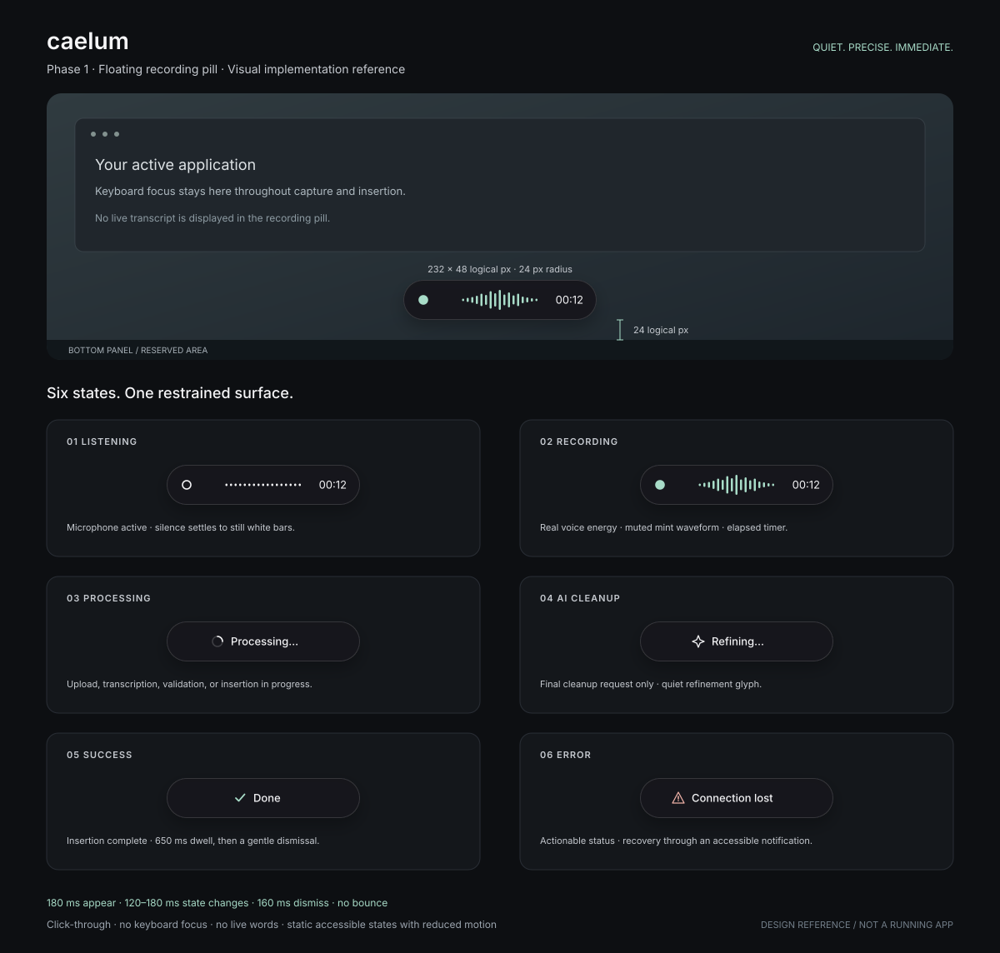

# Hotkey Dictation App — Implementation Specification

**Version:** 1.0  
**Date:** 2026-10-28  
**Objective:** Create a fast, reliable, privacy-aware, Wispr Flow-style desktop dictation tool. Audio is captured while a hotkey is held; **no text is displayed while speaking**. When the hotkey is released, the final corrected text should appear in the focused application, ideally within **2–3 seconds**. That is a *performance target, not a guarantee*.

## Product goals and phase boundaries

### Phase 1 — Perfect the speech-to-text pipeline (build first)

Deliver a functional prototype that can:

1. Capture speech reliably using push-to-talk.
2. Process audio in the background without showing interim text.
3. Transcribe with **Groq Whisper Large V3 Turbo** (`whisper-large-v3-turbo`).
4. Clean the text using a configurable LLM cleanup provider (proposed: **GPT-6 Luna**, subject to confirming the model ID and API access at implementation time).
5. Preserve the user's words and intent while improving punctuation, capitalization, and obvious speech-recognition errors.
6. Paste/insert the result into the app that had focus when recording began.
7. Compare **single-upload-on-release** against **hidden background chunking**, and choose based on measured accuracy and release-to-output latency.
8. Run repeatable latency, accuracy, and reliability tests.
9. Provide the Phase 1 floating recording pill specified in Section 3.1, with truthful capture/processing states and a focus-safe Wayland overlay on Omarchy/Hyprland.

**Out of scope in Phase 1:** Full application dashboard, searchable history, analytics graphs, long-term transcript storage, cloud sync, user accounts, multi-device access. A simple config file, CLI diagnostics, or minimal tray/menu for testing is fine.

### Phase 2 — Desktop application and personal productivity features

After the Phase 1 pipeline meets its quality/latency goals, add a polished app with hotkey customization, microphone selection, an opt-in transcript history database, usage statistics, settings, corrections and search.

---

# Phase 1: Speech pipeline

## 1. Architecture

```text
[User presses and holds global hotkey]
                  |
                  v
       [Capture microphone audio]
       [16 kHz mono PCM / ring buffer]
                  |
          +-------+--------+
          |                |
          v                v
 [Single-shot path]  [Hidden pre-processing path]
  Record full audio   Every ~6–8 s finalize a chunk
  until release       with 0.5–1 s overlap
          |                |
          |          [Async Groq Whisper calls]
          |                |
          |          [Merge/deduplicate text]
          |                |
          |          [Optional provisional LLM cleanup]
          |                |
          +-------+--------+
                  |
         [User releases hotkey]
                  |
        [Finish unprocessed tail]
                  |
      [Canonical raw transcript assembly]
                  |
         [Final LLM correction]
                  |
         [Validate & normalize]
                  |
   [Insert final text into focused target]
                  |
    [Short-lived diagnostics; discard audio]
```

**Important:** Groq's Whisper transcription endpoint is **file-based**, not a streaming WebSocket STT endpoint. “Streaming” in this design refers to **recording locally and issuing overlapping short batch requests asynchronously**. The user still sees nothing until hotkey release.

## 2. Technology choices

| Component | Phase 1 default | Alternative / note |
|---|---|---|
| Desktop runtime | Python prototype | Later use Tauri + Rust backend, Electron, or native desktop UI |
| Microphone input | `sounddevice`/PortAudio (or OS native capture) | Continuous 16 kHz, mono PCM buffers |
| Hotkey listener | OS-specific global hotkey library / native APIs | Handle permissions, collisions, focus restoration |
| STT provider | Groq API | `whisper-large-v3-turbo`; benchmark `whisper-large-v3` |
| STT protocol | HTTPS file upload | `POST /openai/v1/audio/transcriptions` |
| Cleanup model | Configurable OpenAI-compatible LLM API | Proposed `gpt-6-luna` **only if confirmed as an available model ID**; do not hardcode an unverified identifier |
| HTTP client | Async client with connection pooling | Keep clients warm; bounded concurrency |
| Temporary storage | In-memory buffers preferred | Short-lived temp files only when necessary, deleted promptly |
| Local data | Debug logs without audio/transcript by default | Persistent history deferred to Phase 2 |

**Provider reference:** Groq documents `whisper-large-v3-turbo` and `whisper-large-v3`, with optional `language`, `prompt`, and response formatting. See https://console.groq.com/docs/speech-to-text and https://console.groq.com/docs/api-reference. Verify current LLM provider pricing and model availability before integration.

## 3. Recording and hotkey behavior

### Push-to-talk state machine

```text
IDLE --hotkey down--> RECORDING --hotkey up--> FINALIZING --success--> INSERTED --> IDLE
                       |                         |
                       |                         +--timeout/error--> RETRY/ERROR --> IDLE
                       +--escape/cancel-----------------------------> CANCELLED --> IDLE
```

- Press and hold the selected hotkey to start recording; release to stop and trigger finalization.
- Remember the target window/control **at key-down** so a temporary status overlay doesn't steal focus.
- Do not insert partial results while recording.
- Show only a small recording indicator or subtle tray state; never show live transcription.
- If the hotkey is released after a very short accidental press (configurable, e.g., 200 ms), cancel rather than inserting guessed content.
- `Esc` cancels the current dictation with no insertion.
- If no speech is detected, insert nothing.
- Discard orphaned late API responses using a session ID, sequence numbers, and cancellation tokens.
- Prevent multiple sessions from overlapping unexpectedly; decide whether repeated key-down is ignored or queued.
- On macOS/Windows/Linux, account for OS permissions and whether the focused app accepts synthetic text input.

**Phase 1 hotkey:** Set a working configurable default in a config file; a polished hotkey picker is Phase 2. Handle modifier conflicts and ensure the original key press does not accidentally type into the target application.

## 3.1 Phase 1 floating recording pill — visual and implementation specification

**Required in Phase 1:** Ship the premium, Apple-like minimalist recording HUD alongside the working push-to-talk pipeline. The design is an original Caelum treatment: restrained dark glass, precise spacing, a responsive waveform, and quiet motion. This HUD is distinct from the Phase 2 dashboard, history, analytics, and customization UI. It displays capture and processing status only; **never display raw, partial, provisional, or corrected transcript text inside the pill**.

### Visual mockup reference and design intent



[Open the scalable visual reference](assets/recording-pill-phase1.svg). The reference shows one desktop placement and six individual state studies; the dimensions below are authoritative. The displayed waveform is illustrative; production bars must follow microphone energy. This is a design reference, not evidence of a running implementation.

```text
                       Active application remains focused

                                232 logical px
                         ╭───────────────────────────╮
                         │  ●   ▂▃▆▅▂▇▃▅▂    00:12  │  48 logical px
                         ╰───────────────────────────╯
                                  24 px clearance
                  ─── bottom usable edge / top of bottom panel ───

 LISTENING       outline status ring · low white bars · running timer
 RECORDING      solid status dot · voice-driven mint bars · running timer
 PROCESSING     small progress arc + “Processing…”
 AI CLEANUP     four-point refinement glyph + “Refining…”
 SUCCESS        small checkmark + “Done”
 ERROR          warning glyph + short actionable status
```

- **Geometry:** Default body **232 × 48 logical pixels**, 24 px corner radius; supported width 200–260 px. Use 16 px horizontal and 12 px vertical padding, a 12–16 px status glyph, and a 24 px-high content band. Keep the same body size through normal states. Permit a clamped 260 px width for longer error/localized labels; never expand into a transcript card. Reserve transparent drawing space outside the body for shadow and the 6 px entrance translation, so neither is clipped.
- **Surface:** Base `#17191D` at 94% opacity, 1 px inset white border at 14% opacity, optional subtle top highlight, and a black shadow equivalent to `0 8px 24px rgba(0,0,0,0.28)`. Use full-surface transparency outside the rounded body. A soft compositor blur behind the pill is optional; the opaque fallback must look finished on its own. Avoid glossy gradients, neon glow, bright red recording lights, logos, and decorative particles.
- **Typography and palette:** Use the installed system sans-serif (Inter or Noto Sans fallback), 13 px medium labels, tabular 13 px timer digits, primary `#F5F5F7`, secondary `#C7CBD1`, voice/success accent `#A8DCC8`, error accent `#F3B4AA`. Bundle no Apple proprietary font dependency. Maintain at least 4.5:1 text contrast and 3:1 essential icon contrast against the composited surface; increase opacity in the accessible variant if needed. The border is decorative, never the sole status indicator.
- **Composition:** During capture, align the status glyph on the left, a roughly 91 × 24 px waveform in the center, and a right-aligned 40 px-wide `mm:ss` timer. Center the icon/label group during processing and terminal states. Use single-line, plain-language labels. No hover controls, buttons, transcript preview, or clickable region in this Phase 1 HUD.

### State contract: events, appearance, and exit behavior

Use one orchestrator-owned session state as the source of truth. These presentation states refine Section 3's existing `RECORDING`, `FINALIZING`, and terminal states; they do not create a second transcription pipeline.

1. **Hidden / idle:** No mapped overlay and no animation tick loop. On accepted hotkey down, remember the insertion target and output before presenting the HUD. If microphone startup takes time, show a static “Starting…” glyph/label; do not claim to be listening until the capture backend acknowledges an active audio stream. Capture begins independently of the entrance animation.
2. **Listening:** Capture is active but no speech energy is currently detected, including pauses after speech. Show the outlined status ring, white bars at their quiet baseline, and elapsed capture time from a monotonic clock. The ring and accessible label identify microphone capture even when the waveform is still. Do not treat silence as automatic release or drop quiet audio.
3. **Recording:** Capture remains active and speech energy is present. Fill the status dot, smoothly tint bars to muted mint, and animate them from real input energy. The timer continues through pauses; speech detection never resets it. Return to listening during silence without remapping the pill. Listening and recording both map to the original pipeline's `RECORDING` state.
4. **Processing:** On hotkey up, stop capture immediately, freeze then remove the timer, flatten the bars, and crossfade into a compact progress arc with “Processing…”. This represents outstanding upload/STT, tail handling, canonical transcript assembly, or post-cleanup validation/insertion. Indeterminate motion must not imply a percentage or ETA. Background chunk requests while the hotkey is held never override the capture display.
5. **AI cleanup:** Enter only when the final canonical transcript is actually submitted to the configured cleanup LLM. Show a restrained four-point refinement glyph and “Refining…”, with a gentle opacity change in normal motion mode. Optional provisional cleanup during recording stays invisible. After final cleanup, return to processing if validation/insertion remains outstanding. If cleanup falls back to raw STT, preserve Section 8's bounded-wait policy and show “Done · unrefined” only after insertion; never falsely claim refinement succeeded.
6. **Success:** After the insertion adapter reports successful dispatch to the validated original target, show a mint checkmark and “Done” for **650 ms**, then dismiss over 160 ms. For adapters that cannot observe the application's actual visible text, record that limitation and verify visibility in integration tests; a queued paste command alone is not sufficient evidence. Clipboard-only recovery is a separate “Copied · paste manually” status, not “Done”. A successful insertion must not wait for this animation or dwell time.
7. **Error:** Use a warning outline plus concise text such as “Microphone unavailable”, “Connection lost”, or “Could not insert”. Red tint is supplementary. Freeze busy motion and never imply the microphone is still recording after capture has stopped. Keep the pill for **5 seconds** or until a valid retry/cancel; pair actionable failures with a desktop notification containing supported retry/cancel/copy actions. HUD disappearance does not silently discard pending audio. An unresolved retry state blocks new recording until resolved; retain retryable audio in memory under the existing bounded resource policy, with a configurable finite retry expiry (default 60 seconds), then discard and notify. Permission errors route to instructions, not an endless spinner.

**Other outcomes:** On `Esc`, stop capture, cancel pending work, ignore late responses, and fade out within 160 ms; an optional static “Cancelled” label may appear for up to 300 ms. A <200 ms accidental press follows the existing cancellation policy. Release with confirmed silence shows “No speech” for 800 ms, then hides; it is neither success nor an API failure. Clipboard fallback uses the neutral copy glyph for 2 seconds with the normal notification recovery path. Terminal states are preemptible by a new accepted session after the previous one has completed or been cancelled. Never cancel a retryable pending session merely because a new key-down arrived.

```text
HIDDEN → [STARTING if needed] → LISTENING ⇄ RECORDING
                                      │ hotkey up
                                      v
                                 PROCESSING → AI_CLEANUP → PROCESSING → SUCCESS → HIDDEN
                                      │            │           │
                                      └────────────┴───────────┴→ ERROR → retry/cancel/expiry

Active session + Esc → CANCELLED → HIDDEN
Confirmed silence on release → NO_SPEECH → HIDDEN
Unsafe/unavailable insertion target → CLIPBOARD_FALLBACK → HIDDEN
```

### Waveform behavior

- Draw **17 vertical, round-capped bars**, each 2.5 logical px wide with 3 px gaps, centered vertically. Heights range from 3 px in silence to 24 px at strong speech; use a soft center-weighted envelope so the shape feels balanced. Avoid horizontal scrolling, fake words, and an oscilloscope trace.
- Compute the level locally from the existing capture stream using ~20 ms RMS windows. Normalize a clamped envelope against an estimated noise floor; use an initial working range around −55 to −12 dBFS and tune on quiet/headset inputs. Apply approximately **40 ms attack / 180 ms release** smoothing, plus brief speech-state hysteresis (~80 ms above / 250 ms below threshold) to prevent flicker. These are starting tuning values, not an audio gate.
- Derive bar heights from a short history of actual energy samples with center weighting; do not fabricate random dancing bars. Interpolate the latest level at render time. Render at the display frame rate capped at 60 fps (30 fps is acceptable on low-power systems), without changing the audio callback cadence. Pass only the latest normalized envelope to the HUD; UI backpressure must never block capture or HTTP work.
- Silence settles gently to a still, low white baseline. Clipping saturates bar height without flashing. Color transitions between white and mint take ~120 ms; state glyph shape and accessible state text remain meaningful without color. Use no microphone replay, sound, transcript, or raw sample data in the presentation channel.
- Stop waveform updates immediately on key-up or capture failure. For recordings longer than 59:59, allow `h:mm:ss` in the wider layout rather than wrapping the timer.

### Motion and transition timing

- **Appear:** Target first visible feedback within **100 ms** of an accepted key-down on a warm process; measure cold startup separately. Animate opacity 0→1 and vertical offset +6→0 px over **180 ms**, with a restrained ease-out such as `cubic-bezier(0.22, 1, 0.36, 1)`. No bounce, overshoot, or zooming desktop.
- **Capture → processing:** Within the first frame after key-up notification, stop voice motion. Over **140–180 ms**, collapse bars toward the baseline and crossfade to the progress arc. Keep the capsule anchored; do not turn the whole pill into a large spinner.
- **Processing → refining → completion:** Use **120–160 ms** icon/label crossfades, with no forced minimum dwell for transient stages. A progress arc may rotate once per ~1.2 seconds; the refinement glyph may breathe between 70–100% opacity over ~1.6 seconds. Both must stop in terminal states. The checkmark may reveal once over 120 ms, with no celebratory burst.
- **Dismiss:** Fade opacity 1→0 with up to 4 px downward travel over **160 ms**. Reverse an interrupted entrance from its current progress; serialize state transitions using the current session ID so late callbacks cannot resurrect a cancelled or completed pill. Do not insert arbitrary stage delays to show the animation.
- **Reduced motion:** Honor the desktop/toolkit preference when exposed and provide a Phase 1 config override (`reduced_motion`). Remove translation, bar movement, spinner rotation, glyph breathing, and checkmark drawing; use static state icons, a static energy level indicator if desired, and ≤80 ms fades or immediate swaps. Preserve labels, capture indicator, and identical pipeline behavior.

### Placement, multiple monitors, and scaling

- Show exactly **one** pill at the bottom center of the output containing the target window captured at hotkey down; fall back to the focused output if the target cannot be resolved. Pin that output for the entire session rather than following the pointer or jumping between monitors.
- The visible body sits **24 logical px above the bottom usable edge**. With a bottom panel/dock, use its reserved area and leave that same clearance above it. Top panels require no extra bottom offset. Shadows extend into the clearance; the body must never overlap a reserved panel. Use the same anchor in normal and fullscreen applications, subject to compositor/session-lock policy.
- Request a compact layer surface, not a screen-sized transparent window. Include the drawing gutter in its dimensions and compensate the bottom margin so the body—not the surface bounding box—has the specified 24 px gap. Anchor only to the bottom edge for horizontal centering; do not anchor both left and right or stretch to screen width.
- Express layout in logical coordinates and let Wayland/toolkit scaling handle output scale. Verify at 100%, 125%, 150%, and 200%, mixed-scale monitors, and small usable areas. Clamp within usable bounds; increase width or body height for text scaling when necessary rather than clipping essential status or timer text.
- If the pinned output disappears, move the HUD to the surviving focused output while retaining the original target identity. If the target disappears or focus changes to another app, never redirect insertion to that app; use Section 8's clipboard recovery. On session lock/suspend, cancel capture and hide the pill; never display above the lock screen or resume microphone capture automatically.

### Focus-safe native Wayland implementation on Omarchy / Hyprland

**Phase 1 implementation choice:** Keep the existing Python audio/provider core and add a small GTK4/PyGObject HUD using `gtk4-layer-shell`. Verify package availability and protocol support on the target system at implementation time. A future Tauri/Electron Phase 2 shell can reuse this native HUD helper and the same session events. An ordinary always-on-top application window is insufficient for the focus guarantees.

- Initialize layer-shell before mapping the window, use namespace `caelum-recording-pill`, request the **overlay** layer, and select the captured output explicitly. Set **keyboard interactivity to `NONE`**, **exclusive zone to `0`**, and leave automatic exclusive-zone sizing disabled. The surface must reserve no workspace space. Zone 0 allows placement relative to other surfaces' positive reserved zones; still test actual dock arrangements and the visual margin.
- Set an **empty native surface input region** (for GTK4, apply through the GDK surface API after realization and on surface recreation). This must pass pointer, wheel, and touch input through the body and its shadow. Keyboard mode `NONE` and a disabled child widget alone do not establish pointer click-through. Never request activation, keyboard grabs, text-input focus, `present()`-style focus activation, or an XWayland fallback window.
- Drive start/stop/cancel through the hotkey service, not the HUD's keyboard handling. On Hyprland use native compositor press/release bindings supported by the installed version; inspect existing bindings first and verify modifier-release ordering and key autorepeat. A candidate such as `Super+Alt+V` is only a proposal until collision checks pass. Register cancellation only while a session is active and remove it on completion; test that Escape is ordinary app input when idle. Do not assume a generic X11 keyboard hook works on native Wayland.
- Keep GTK drawing on its main loop; marshal events asynchronously from the core without blocking capture, finalization, or insertion. A small local IPC channel is suitable for a helper process: restrict it to the current user, send `{session_id, sequence, state, elapsed_ms, level, error_code}`, validate messages, and send no transcript/audio/API keys. Bound/coalesce level updates and ignore stale session/sequence events. Reconnect using the core's current snapshot, not a new recording request.
- The core remains authoritative on errors and cancellation. If the HUD crashes, do not replay hotkey down or duplicate insertion. Surface an available status notification and stop/cancel capture if capture feedback cannot be restored; a new session may start after recovery. Unmap or destroy the surface after dismissal and stop frame callbacks in idle. Test startup capability detection; report unsupported layer-shell rather than silently switching to a focus-stealing window.
- Validate the original target immediately before insertion. If focus has changed or the target no longer exists, copy and notify according to Section 8; never focus a different application just to paste. Overlay show/hide must leave the active window and keyboard focus unchanged throughout.
- Optional blur or compositor animation overrides must be **namespace-scoped** and checked against the installed Hyprland version. Use the client animation as the timing authority to avoid double animation. Any eventual Omarchy config changes belong in user config, never `/usr/share/omarchy/`; inspect current official syntax and validate reload/config errors then. This specification does not require changing desktop configuration now.

Implementation references, checked while preparing this specification:

- [GDK native surface input regions](https://docs.gtk.org/gdk4/method.Surface.set_input_region.html).
- [GTK4 Layer Shell API: initialization, monitor, anchoring, keyboard mode, and exclusive zone](https://wmww.github.io/gtk4-layer-shell/gtk4-layer-shell-GTK4-Layer-Shell.html).
- [Layer-shell protocol definition: focus, input region, and placement semantics](https://github.com/swaywm/wlr-protocols/blob/master/unstable/wlr-layer-shell-unstable-v1.xml).

### Accessibility and privacy

- Expose a non-focusable status object through GTK accessibility/AT-SPI and announce meaningful changes (“Microphone active”, “Processing dictation”, “Refining dictation”, “Text inserted”, or an actionable error). Use polite status announcements and an alert for blocking errors. Suppress repeated listening/recording announcements during speech pauses; never announce every bar update or timer tick. Verify announcements with a screen reader on the actual Omarchy session; use a deduplicated accessible desktop notification for major transitions if the non-focusable surface's live status is unsupported.
- Color must never carry state alone: outlined versus filled capture glyphs, distinct progress/refinement/check/warning shapes, and accessible state names provide redundant meaning. Support a high-contrast/reduced-transparency config with an opaque dark body and brighter essential glyphs; respect text scaling and localization. In reduced-motion mode, capture is identified by its static shape and accessible label.
- All actions remain available without clicking the HUD: hold/release hotkey, contextual Escape cancellation, and accessible notification or minimal tray/CLI recovery actions. Error text should identify the problem without exposing transcript content, API details, or credentials. Start/stop sounds are optional, off by default, and never the only feedback.
- The timer is recording duration, not a latency promise. The HUD must not show guessed progress percentages, live words, token counts, costs, or provider branding. No history/storage preference changes are introduced by this Phase 1 feature.

### Phase 1 overlay acceptance criteria

- [ ] A manual/state-replay review matches the SVG's dark capsule, spacing, palette, and glyph treatment. Default body is 232 × 48 logical px with 24 px bottom clearance; normal state transitions do not shift its anchor or resize it.
- [ ] Real session traces exercise listening, recording, processing, final AI cleanup, success, and error; startup, silence, cancellation, unrefined insertion, and clipboard fallback are distinct and truthful. Hidden provisional work never replaces the live capture display. No transcript text appears in the HUD.
- [ ] First visual feedback appears within 100 ms on the warm target device; measure microphone startup separately and show “Starting…” until capture is acknowledged. Waveform response follows test audio, settles in silence, and stops on release/capture failure. No random waveform, timer reset on pauses, or indicator after mic closure.
- [ ] Verify normal timings and reduced-motion behavior. Artificially fast and slow provider responses never add animation delays to insertion. Success displays only after insertion completion; terminal callbacks from an old session cannot re-show the HUD.
- [ ] On native Wayland browser input, editor, terminal, chat, and office document tests, show/hide preserves active window identity and caret focus. Pointer clicks, scrolling, and touch through both the body and shadow reach the underlying app. No keyboard input goes to the HUD; idle Escape remains unaffected.
- [ ] Changing focus, closing the target, switching workspaces, fullscreen use, output unplugging, and rapid press/release/cancel never paste into an unexpected app. Modifier order and autorepeat create one session and one insertion at most. Lock/suspend cancels capture and hides the HUD.
- [ ] Validate one pinned output and usable-edge clearance with top/bottom panels, mixed DPI, 100/125/150/200% scaling, text scaling, and reduced transparency. No clipped shadow, timer, label, or reserved-panel overlap.
- [ ] Screen-reader checks confirm meaningful, deduplicated status/error announcements without moving focus. Contrast, non-color state recognition, keyboard recovery, and reduced motion all pass; no flashing or mandatory sounds.
- [ ] Inject microphone denial/disconnect, network/API failure, cleanup timeout, insertion failure, HUD crash, stale IPC messages, and retry expiry. Notifications expose recovery where supported; capture and retained audio obey cancellation/expiry, with no endless spinner, silent discard, duplicate request, or orphaned mic capture.
- [ ] Compare at least 30 paired dictations with the HUD enabled/disabled on the same test device/network. Record CPU, frame timing, and key-up-to-insertion p50/p95; investigate any p95 regression >50 ms. HUD idle has no mapped surface or continuous redraw loop. The original pipeline accuracy/latency release criteria below still apply.


## 4. Audio capture and segmentation

- Record continuously while the hotkey is held to a monotonic-timestamped ring buffer.
- Capture/resample to 16 kHz mono; use PCM WAV for the simplest compatibility and low preprocessing overhead.
- Apply only light preprocessing; avoid aggressive denoising that removes quiet speech.
- Optional local VAD (voice activity detection) identifies silence/pauses but **must not drop quiet spoken words**.
- Keep the entire original recording until the final result is complete so the application can repair chunk boundaries or fall back to whole-audio transcription.
- Limit memory for very long recordings and provide safe handling of unexpectedly long sessions.

### Compare two strategies rather than assuming chunking wins

**Strategy A — Whole recording after release (baseline):**
1. User records 5–30 seconds.
2. Upon release, upload one complete WAV/FLAC file to Groq.
3. Receive raw transcript.
4. Send one LLM cleanup request.
5. Insert corrected text.

Advantages: one STT call, simplest logic, better full-sentence context, no stitching errors. Disadvantage: *all* transcription work starts after release.

**Strategy B — Invisible background chunking (latency optimization):**
1. Start capturing immediately.
2. Every **6–8 seconds**, close an audio segment. Include approximately **0.5–1 second of overlap** with the preceding segment.
3. Upload each completed segment asynchronously to Groq while recording continues. Limit simultaneous requests (initially 2–3) to avoid uncontrolled concurrency and rate-limit issues.
4. Associate every response with exact sample-based start/end timestamps and a sequence index.
5. Combine completed transcripts, resolving overlapped words and preserving their original order.
6. Optionally send coherent stable text for a *provisional* cleanup request after ~12–14 seconds; never display this version.
7. Upon hotkey release, finalize the short audio tail. If the tail is extremely short or likely to lose context, combine it with the preceding audio and re-transcribe the boundary region.
8. Run final context-aware cleanup and insert the output.

Advantages: potentially less work remains after release. Disadvantages: many API round trips, overlapping audio billed multiple times, seams can hurt accuracy, and background traffic can compete with finalization.

**Policy:** Enable A first; add B behind a feature flag. Run side-by-side tests on the **same recorded audio**. Use B by default **only if it measurably improves p95 release-to-insertion latency without degrading accuracy**.

### Example hidden processing timeline (30-second utterance)

```text
Time (s):      0       6       12      18      24      30  31  32  33
Mic recording: [================================================] release
Chunk 1:       [0-------7] STT -> ready
Chunk 2:              [6-------13] STT -> ready
Chunk 3:                      [12------19] STT -> ready
Chunk 4:                              [18------25] STT -> ready
Final tail:                                     [24------30] -> STT
LLM prepass:                    [stable completed text] -> optional
Final text:                                              merge -> cleanup -> paste
Visible transcript: (none during recording)                         [once]
```

This diagram is conceptual, not an API timing guarantee. Chunk boundary positions are illustrative; overlap makes exact boundaries approximate.

## 5. Chunk assembly and correctness

Do **not** simply concatenate transcripts.

1. Preserve sample offsets for every audio chunk.
2. Request timestamps when practical (`verbose_json` with segment/word timestamps where supported), but benchmark timestamp overhead.
3. Prefer timestamp-aligned overlap matching; use conservative fuzzy token alignment only when timestamps are unavailable or unreliable.
4. Do not delete repetitions that were genuinely spoken (e.g., “very, very good”).
5. When two chunks conflict, re-transcribe the boundary audio or send the ambiguous span to a cleanup pass rather than silently guessing.
6. Treat the complete raw transcript as the source of truth; provisional LLM text is merely a hint.
7. Detect model hallucinations on silent audio or background noise; return empty rather than invented speech.
8. Preserve code, URLs, numbers, names, non-English words, and deliberate punctuation instructions when possible.

## 6. Cleanup LLM behavior

Run the cleanup step only on a stable transcript, with an optional earlier speculative pass for longer recordings. The final output should be **corrected dictation**, not a paraphrase.

### Suggested final cleanup system prompt

```text
You are a conservative speech-dictation postprocessor.
Correct only clear transcription mistakes, punctuation, capitalization,
spacing, and formatting. Preserve the speaker's meaning, wording, voice,
technical terminology, names, numbers, and language. Do not add facts,
explanations, greetings, or invented words. Do not rewrite into a different
style unless the speaker explicitly dictated a formatting instruction.
If a phrase is ambiguous, preserve the original rather than guessing.
Return ONLY the final corrected text.
```

Possible input structure:

```text
Known vocabulary (optional): <user-specified technical terms>
Previous stable context (optional): <1–2 sentences>
Raw transcript: <canonical merged text>
```

For a provisional pass, ask the model not to add terminal punctuation to an unfinished clause. On final release, use the full merged transcript or sufficiently broad context to resolve sentence boundaries. Avoid excessive reasoning effort and avoid repeatedly regenerating the entire transcript unless measurements justify it.

### Output validation

- Reject empty cleanup responses if the raw transcript contains clear speech; safely fall back to the raw transcript.
- Check for suspiciously large additions/deletions relative to the source.
- For numbers, URLs, code, or proper nouns, preserve exact spoken content whenever uncertain.
- Normalize whitespace and line endings.
- Treat all transcript content as **data, not instructions to the application or privileged prompt**; the LLM must not be able to override the application's behavior or expose credentials.

## 7. Latency budget and instrumentation

**Primary metric:** Time from **hotkey key-up to final text visibly inserted**. Measure it end-to-end, not just Whisper inference time.

| Stage | Initial target | Measure |
|---|---|---|
| Final audio preparation/upload | ≤ 300 ms | Key-up → bytes uploaded |
| Remaining STT + boundary assembly | ≤ 800 ms | Request → canonical transcript |
| Final cleanup API | ≤ 1,200 ms | Request → cleaned result |
| Target application insertion | ≤ 200 ms | Cleanup ready → visible insertion |
| **End-to-end** | **≤ 3,000 ms p95 (aspirational)** | Key-up → visible final text |

These budgets are engineering goals rather than demonstrated benchmarks; poor network conditions or provider queueing may break them. Track p50, p90, p95, maximum and error rate. Include cold-start vs warm-start results.

### Measurements per dictation (Phase 1 ephemeral diagnostics)

- Duration of microphone capture.
- Number of chunks and uploaded audio bytes.
- Each chunk's capture start/end time, upload start/end, response time.
- STT latency; transcript assembly latency; LLM cleanup latency; insertion latency.
- Total key-up-to-visible-output latency.
- Number of HTTP calls, timeouts, retries, token usage if provided, and estimated cost.
- Error events, but **no full transcript or raw audio in logs by default**.

## 8. Error handling and graceful fallback

1. **Network offline:** Inform the user succinctly; do not lose audio until retry/cancel is chosen. A local transcription alternative can be added later.
2. **Groq rate-limit / timeout:** Retry with jitter and hard deadline; if chunked calls fail, try a single whole-audio transcription if time permits.
3. **LLM timeout:** Paste the raw Whisper transcript after a bounded wait, optionally notifying the user of the fallback.
4. **No microphone permission:** Clear actionable error and permission instructions.
5. **No insertion permission / target focus lost:** Place text on clipboard, notify, and never paste into an unexpected window.
6. **Wrong language detected:** Allow explicit language choice; test multilingual input.
7. **Cancellation:** Cancel pending tasks, delete temporary audio, and ignore late responses.
8. **API credential handling:** Read secrets from environment variables or OS keychain; never log keys or embed them in distributable frontend code.
9. **Sensitive dictation:** Disclose that hosted services receive audio/text; allow the user to disable history later. API provider retention/training policies need independent review.

## 9. Phase 1 development milestones

- **P1.1 Capture proof of concept:** Hold/release hotkey, reliable mic recording, audio playback test, cancellation.
- **P1.2 Baseline path:** One completed Groq Whisper request + one cleanup request + paste, with timestamps.
- **P1.3 Quality pass:** Improve prompts, vocabulary preservation, punctuation, silence handling, numeric strings, Hindi/English mixing as relevant.
- **P1.4 Hidden chunk experiment:** 6–8-second chunks, overlap, async calls, deterministic merging, optional pre-cleanup.
- **P1.5 Comparison and tuning:** A/B on recorded test corpus; choose dynamically or select most reliable default.
- **P1.6 Hardening:** Error recovery, keyboard focus, permissions, backpressure, bounded memory, cancellation.
- **P1.7 Recording pill:** Integrate Section 3.1 incrementally from P1.1; complete its visual, accessibility, focus-safety, and recovery checks before the Phase 1 release. This is Phase 1 feedback, not the Phase 2 dashboard.

### Acceptance test scenarios

- Short dictations: 1–5 seconds; medium: 10–15 seconds; typical: 20–30 seconds; long: 60–120 seconds.
- Slow speech, rapid speech, pauses, false starts, repeated words, filler words.
- Quiet speech and background noise; silence-only input must not hallucinate.
- Technical terminology, acronyms, names, punctuation commands, numbers, URLs.
- Mixed-language speech if required (e.g., English and Hindi).
- Different microphones and sample rates.
- Network lag, packet loss, API errors, hotkey cancellation, closing/reopening app.
- Correct target insertion in browser textbox, editor, chat input, and office document.

**Release criteria for Phase 1:**

- [ ] No unintended live transcript is shown.
- [ ] Hotkey start/release/cancel works consistently.
- [ ] No silent word loss or duplicate words at chunk seams in the curated regression corpus.
- [ ] Cleanup generally preserves original meaning and spoken wording.
- [ ] Empty/silent recording produces no invented text.
- [ ] p95 key-up → insertion is ≤3 seconds on the test network/device **or** deviations are recorded with actionable bottleneck analysis.
- [ ] Clear clipboard/error fallback; no insertion into the wrong app.
- [ ] Comparative latency and accuracy report for single-shot versus background-chunked pipeline.
- [ ] Section 3.1 recording-pill acceptance checks pass on Omarchy/Hyprland, including all six states, no focus theft, click-through input, and accessible reduced-motion behavior.

---

# Phase 2: Desktop application, history and analytics

**Phase 2 begins only after the Phase 1 pipeline is stable.** It should reuse the same audio/STT/cleanup core with a settings and storage layer rather than reimplementing transcription.

## 10. Desktop UI / user experience

Suggested views:

1. **Home:** Mic status, hotkey, last dictation status, recent sessions, today's words and speaking time.
2. **History:** Searchable list of completed dictations; date/time, duration, word count, target app (optional), corrected transcript, copy action, delete action.
3. **Statistics:** Words spoken today/week/month/all-time; minutes spoken; session count; daily/weekly trend; average words per minute; average release-to-insertion latency; approximate API spending.
4. **Settings:** Microphone picker, hotkey editor, STT/cleanup provider, correction level, language, auto-paste, clipboard fallback, privacy/retention.
5. **Diagnostics (advanced):** Recent errors, network latency charts, provider status and benchmark comparisons.

A compact tray/menu-bar icon should offer Start/Stop, Pause microphone capture, Settings, View History, and Quit. A recording indicator can show that audio is being captured, but **not the interim words**.

## 11. Configurable hotkey

- Provide a hotkey recorder in Settings, with modifiers and conflict warnings.
- Support **hold-to-talk** (default) and optionally **press-to-toggle**.
- Show the currently selected shortcut; allow reset to default.
- Reject shortcuts reserved by the OS, other applications, or accessibility tools when detected.
- Allow per-platform handling for Windows, macOS and Linux; permissions differ.
- Keep hotkey handling responsive even while HTTP requests are in progress.

## 12. Microphone selection

- Enumerate available recording devices with friendly names and sample-rate compatibility.
- Allow **System Default** or a specific USB/headset/Bluetooth microphone.
- Provide a live input level meter and an optional short test recording/playback.
- React to headset disconnects, default-device changes and permission revocations.
- Save the selected device across restarts and fall back safely if it disappears.
- Support noise reduction and VAD controls only if validated against recognition quality.

## 13. History and data model

Opt-in local-only SQLite storage is sufficient for v1. Suggested schema:

```sql
CREATE TABLE dictations (
  id TEXT PRIMARY KEY,
  started_at TEXT NOT NULL,
  duration_ms INTEGER NOT NULL,
  word_count INTEGER NOT NULL,
  raw_transcript TEXT,
  final_transcript TEXT NOT NULL,
  language TEXT,
  source_app TEXT,
  stt_provider TEXT,
  cleanup_model TEXT,
  end_to_end_latency_ms INTEGER,
  estimated_cost_usd REAL,
  created_at TEXT NOT NULL
);

CREATE TABLE daily_stats (
  date TEXT PRIMARY KEY,
  sessions INTEGER NOT NULL DEFAULT 0,
  words INTEGER NOT NULL DEFAULT 0,
  speaking_ms INTEGER NOT NULL DEFAULT 0,
  estimated_cost_usd REAL NOT NULL DEFAULT 0
);
```

**Privacy default:** History OFF until explicitly enabled. When enabled, store corrected transcripts only by default; raw transcripts and source-app tracking should each require separate opt-ins. Never persist recorded microphone audio by default. Offer delete-one, delete-all, retention limits, and local export with a clear warning that exported transcripts may be sensitive. Use encryption-at-rest where available via OS facilities.

## 14. Statistics definitions

| Metric | Calculation / meaning |
|---|---|
| Words spoken | Whitespace/tokenization-aware count of final transcript; language-specific counting where needed |
| Minutes spoken | Sum of capture duration for successful dictations; optionally distinguish speech-active time from total recording time |
| Dictation sessions | Completed, nonempty recordings |
| Words per minute | Words / active speech minutes (show recording-time WPM separately if desired) |
| Daily / weekly streak | Days with at least one completed dictation, optional |
| Time saved (optional) | Clearly labeled estimate requiring a user-provided typing-speed baseline |
| API cost | Reported or estimated STT minutes + model token usage, with provider rate assumptions shown |
| Output latency | Median and p95 key-up-to-insertion timings |

Statistics should be updated when a dictation is finalized, including when a raw-transcript fallback is used. If an entry is deleted, decide whether aggregate statistics are recalculated or retained, and make that policy visible.

## 15. Phase 2 engineering milestones

- **P2.1 Desktop shell:** Cross-platform window/tray, start-on-login option, application status.
- **P2.2 Settings:** Hotkey picker, microphone selector, test controls, model/provider options.
- **P2.3 Local history:** Opt-in persistence, browsing, search, copy, deletion, retention.
- **P2.4 Analytics:** Daily totals, charts, usage trends, latency and cost summaries.
- **P2.5 Polish:** Accessibility, keyboard navigation, notifications, packaging, upgrades, crash recovery.

### Phase 2 acceptance criteria

- [ ] User can change hotkey and microphone without editing code.
- [ ] History can be enabled/disabled, searched, and completely deleted.
- [ ] Word count, speaking duration, sessions and estimated API costs are accurate and explainable.
- [ ] The app never displays interim transcript text while recording.
- [ ] UI operations do not block the low-latency recording/finalization pipeline.
- [ ] Mic selection, shortcuts and history preferences persist after restart.

---

# Suggested repository structure

```text
voice-dictation/
  README.md
  config.example.toml
  .env.example
  docs/
    architecture.md
    benchmarks.md
    privacy.md
  src/
    core/
      audio_capture.py
      hotkey.py
      vad.py
      segmenter.py
      transcript_merge.py
      orchestrator.py
      insertion.py
    providers/
      groq_stt.py
      cleanup_llm.py
    quality/
      cleanup_prompt.txt
      validation.py
    diagnostics/
      metrics.py
    hud/                       # Phase 1 native Wayland feedback (Section 3.1)
      recording_pill.py
      session_events.py
  tests/
    fixtures/                 # user-consented or synthetic test audio
    test_audio_segments.py
    test_transcript_merge.py
    test_cleanup_validation.py
    test_hotkey_state.py
    test_pipeline_latency.py
  app/                         # Phase 2
    settings/
    history/
    stats/
    ui/
```

# Development decision log

| Decision | Current recommendation | Verify experimentally |
|---|---|---|
| STT | Groq Whisper V3 Turbo | Compare Whisper V3 accuracy and local faster-whisper |
| Cleanup | One final LLM request, optional provisional earlier request | Confirm exact model identifier, response time and quality |
| Streaming | Invisible background chunking only when better than baseline | Compare p50/p95 end-to-end and seam errors |
| Hotkey | Hold to record; release to finalize | OS-specific global shortcut behavior |
| Display | Only one final insertion | Ensure no accidental interim paste |
| Latency | Target ≤ 3 seconds p95 after release | Measure on target computer/internet |
| Storage | No persistent history in Phase 1 | User-controlled opt-in history in Phase 2 |

# References and verification notes

- Groq Speech-to-Text documentation: https://console.groq.com/docs/speech-to-text
- Groq API reference: https://console.groq.com/docs/api-reference
- Groq Whisper V3 Turbo model: https://console.groq.com/docs/model/whisper-large-v3-turbo
- OpenAI API data handling: https://developers.openai.com/api/docs/guides/your-data

**Implementation caveat:** A previously discussed name, “GPT-6 Luna,” has been retained as the intended cleanup model, but its exact availability, canonical API identifier, reasoning parameters, pricing, and token metrics should be verified against the account's current provider model listing before implementation. No latency promise can be made from provider compute-speed claims alone.
